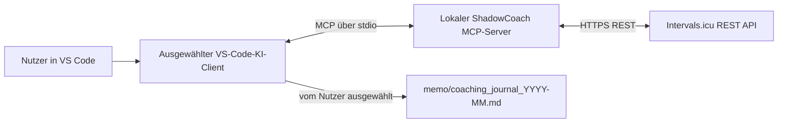

# ShadowCoach – Anforderungsspezifikation 4.0

**Dokumentenversion:** 4.0 – MCP Analyse-Center  
**Status:** Architekturwechsel  
**Zielgruppe:** Entwicklung und Nutzer des lokalen Analyse-Centers

## 1. Ziel und Abgrenzung

ShadowCoach ist ein lokales Analyse-Center für Daten aus Intervals.icu. Die
Bedienung erfolgt in VS Code über einen lokalen MCP-Server, der auf Anfrage des
ausgewählten VS-Code-KI-Clients die REST-API aufruft.

Der bisherige Signal-Bot, der Ubuntu-Home-Server, OpenRouter-Workflow und der
separate OpenRouter-Sanitizer sind verworfen. Es gibt keinen ShadowCoach-Daemon,
keine automatische Synchronisation und keine autonome Trainingssteuerung.
Intervals.icu bleibt die führende Datenquelle. Der MCP-Server kann mit den
Zugangsdaten des Nutzers auch API-Änderungen und Löschungen ausführen.

## 2. Architektur und Datenfluss



- Der MCP-Server läuft lokal als Kindprozess von VS Code über stdio.
- Die Verbindung zur Intervals.icu REST-API erfolgt verschlüsselt über HTTPS.
- Das Werkzeug `intervals_api_request` kann beliebige REST-Pfade unter der
  fest kodierten Intervals.icu-API-Basis-URL und die Methoden GET, POST, PUT,
  PATCH, DELETE, HEAD und OPTIONS aufrufen. Anfrageparameter und JSON-, Text-
  oder Base64-Inhalte können übergeben werden. Antworten werden ungefiltert
  ausgegeben. Pfade zu anderen Hosts und relative Pfadsegmente werden abgelehnt.
- Für jede Methode außer GET fordert das Werkzeug vor dem HTTP-Aufruf über
  MCP-Elicitation eine Bestätigung mit Methode, URL, Parametern und Nutzdaten
  an. Ohne ausdrückliche Annahme wird die Anfrage abgebrochen. Unterstützt der
  MCP-Client Elicitation nicht, schlägt der Aufruf geschlossen fehl.
- Agenten müssen zusätzlich vor jedem solchen Werkzeugaufruf den Nutzer im Chat
  um Bestätigung genau dieser Anfrage bitten. Die Bestätigung gilt nicht für
  spätere oder veränderte Anfragen. Verbindliche Repo-Regeln stehen in
  `AGENTS.md` und `.github/copilot-instructions.md`.
- Der Server hat dadurch Zugriff auf alle API-Ressourcen, für die der
  konfigurierte API-Schlüssel berechtigt ist. Das umfasst gegebenenfalls
  personenbezogene Daten und schreibende oder löschende Aktionen.
- Die API-Antworten gelangen in den Kontext des in VS Code ausgewählten
  KI-Modells. Der verwendete Modellanbieter und dessen Datenverarbeitung hängen
  von der VS-Code-Konfiguration des Nutzers ab; lokale MCP-Ausführung bedeutet
  nicht automatisch lokale Inferenz.

## 3. Zugangsdaten und API

- Basis-URL: `https://intervals.icu/api/v1`
- Authentifizierung: HTTP Basic Auth mit Benutzername `API_KEY` und dem
  persönlichen Intervals.icu-API-Schlüssel als Passwort.
- Athlete-ID und API-Schlüssel werden lokal in der nicht versionierten
  Workspace-Datei `.env` abgelegt und vom MCP-Server beim Start geladen.
  Zugangsdaten gehören nicht in Journale, Quellcode oder Versionskontrolle.
- Die spezialisierten Analysewerkzeuge unterstützen:
  - `GET /athlete/{athlete_id}/activities` mit `oldest`, `newest` und `limit`
  - `GET /athlete/{athlete_id}/wellness` mit `oldest` und `newest`
- Datumswerte verwenden `YYYY-MM-DD`; Standardzeitraum ist der heutige Tag und
  die davorliegenden 30 Tage. Der Abruf von Aktivitäten ist auf 100 Datensätze
  je Anfrage begrenzt.
- Das allgemeine REST-Werkzeug verwendet keine eigene Feld-Allowlist oder
  Zeitraumbeschränkung; API-seitige Berechtigungen und Beschränkungen bleiben
  maßgeblich.
- HTTP- oder Antwortfehler werden als Werkzeugfehler sichtbar gemacht. Es gibt
  keine stillen Ersatzantworten.

## 4. Werkzeuge und Datenfelder

### Aktivitäten

`get_activities(oldest, newest, limit)` liefert die vorhandenen Felder aus
dieser Auswahl: `id`, `type`, `start_date_local`, `moving_time`, `elapsed_time`,
`distance`, `total_elevation_gain`, `average_watts`, `icu_weighted_avg_watts`,
`average_heartrate`, `max_heartrate`, `average_speed`, `max_speed`,
`icu_training_load`, `icu_intensity_factor` und `kilojoules`.

### Wellness

`get_wellness(oldest, newest)` liefert die vorhandenen Felder aus dieser
Auswahl: `date`, `ctl`, `atl`, `tsb`, `hrv`, `hrvSDNN`, `restingHR`, `sleepSecs`,
`sleepScore`, `soreness`, `fatigue` und `stress`.

Diese Feldauswahl gilt nur für die spezialisierten Werkzeuge. Das allgemeine
REST-Werkzeug gibt ungefiltert die angeforderte API-Antwort zurück.

## 5. Lokales Coaching-Journal

Das Journal ist ein manuell gepflegtes Markdown-Protokoll. Es ist optional;
MCP-Abfragen werden nicht automatisch gespeichert. Es gibt keine SQLite- oder
Cloud-Synchronisation durch ShadowCoach.

```text
memo/
└── coaching_journal_YYYY-MM.md
```

Pro Kalendermonat wird eine Datei mit dem Monatsnamen angelegt, z. B.
`memo/coaching_journal_2026-11.md`. Zugangsdaten, GPS-Daten und nicht benötigte
personenbezogene Angaben gehören nicht ins Journal. Die Synchronisation solcher
Dateien (z. B. Git oder Syncthing) liegt außerhalb des Projekts und muss bewusst
eingerichtet werden.

Ein Journal-Eintrag kann diese Form verwenden:

```markdown
## YYYY-MM-DD HH:MM – Thema

**Frage**

**Datenbasis**
- Zeitraum:
- Relevante Kennzahlen:

**Analyse**
- Fakten:
- Interpretation:
- Empfehlung / offene Fragen:
```

## 6. Projektstruktur

```text
.vscode/
└── mcp.json                    # VS-Code-Verbindung
.env                            # Lokale Zugangsdaten (nicht versioniert)
.env.example                    # Variablennamen ohne Zugangsdaten
docs/
└── anforderung.md              # Diese Spezifikation
memo/
└── coaching_journal_YYYY-MM.md # Ein Journal pro Monat
scripts/
└── intervals_mcp.py            # Lokaler MCP-Server
tests/
└── test_intervals_mcp.py       # Tests für Feldprojektion und Eingaben
pyproject.toml                  # Python- und MCP-Abhängigkeiten
```

## 7. Abnahme und Betrieb

- Voraussetzung ist Python 3.11 oder neuer und `uv` im VS-Code-PATH. `uv run`
  richtet die in `pyproject.toml` deklarierten Abhängigkeiten automatisch ein.
- VS Code kann den MCP-Server mit `.vscode/mcp.json` starten.
- API-Schlüssel und Athlete-ID liegen ausschließlich in der lokal ignorierten
  `.env`; `.env.example` enthält keine echten Zugangsdaten.
- Die REST-Verbindung verwendet ausschließlich die festgelegte
  Intervals.icu-API-Basis-URL.
- Das allgemeine REST-Werkzeug gibt ausdrücklich ungefilterte API-Daten zurück;
  vor jeder Anfrage außer GET sind Methode, Pfad, Parameter und Nutzdaten zu
  prüfen und die ausdrückliche Nutzerbestätigung einzuholen.
- Ungültige Datumsbereiche, API-Fehler und ungültige API-Antworten werden
  ausdrücklich gemeldet.
- Das Journalverzeichnis enthält eine monatliche Markdown-Datei; das Schreiben
  erfolgt bewusst durch den Nutzer.
